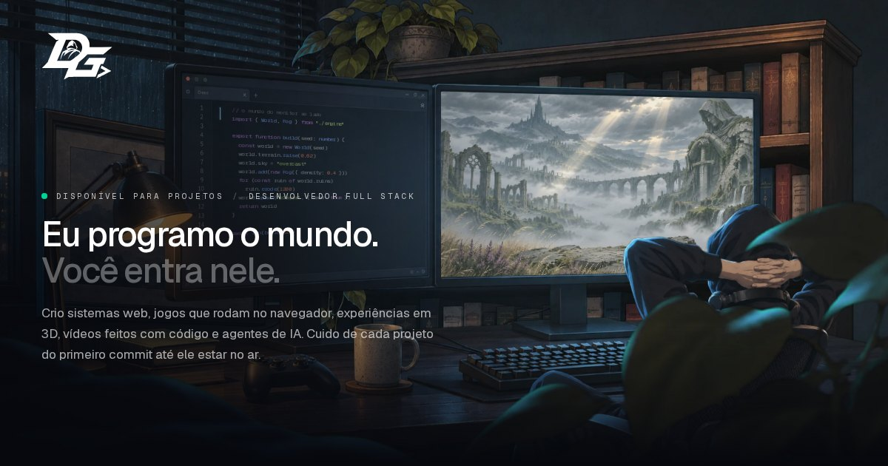

# diorgenesgeorge.dev

[](https://diorgenesgeorge.dev)



Site pessoal de **Diorgenes George**, desenvolvedor full stack de sistemas, jogos, 3D, vídeos feitos em código e agentes de IA.

**No ar:** https://diorgenesgeorge.dev (em inglês, português e espanhol).

## A ideia: "Eu programo o mundo. Você entra nele."

O hero é o quarto de um dev à noite, montado em camadas com parallax, com chuva, vapor e código rolando no monitor. O seletor de tema é o **Build & Run**: ao apertar Enter, a tela engole o quarto, ele se quebra em pixels e vira o mundo do jogo que o dev está programando, uma fantasia sombria de ruínas e névoa.

- **Tema escuro:** o quarto, o código e o jogo rodando no outro monitor.
- **Tema claro:** o mundo do jogo, com HUD de XP e nível, conquistas e o código Konami.
- **Telas** (Trabalhos, Jogos, Sobre e Contato) abrem como portais que saem do monitor (no tema escuro) ou do mundo (no tema claro), cada uma com a sua própria cena em parallax.
- **Contato** é um quadro de missões: "Publique uma missão".

## Stack

| Área | Ferramentas |
|---|---|
| Framework | Next.js 16 (App Router, export estático), React 19 e TypeScript |
| Estilo | Tailwind CSS 4 |
| Animação | GSAP, Lenis e shaders WebGL (sucção em pixels, névoa e luz do monitor) |
| Hospedagem | Cloudflare Workers com Static Assets, num Worker mínimo que só redireciona `/` para `/en/` |
| Mídia | Vídeos e imagens gerados com IA e tratados com scripts em Python, ffmpeg e Playwright |

## Como rodar

```bash
npm install
npm run dev        # http://localhost:3000
npm run build      # gera o export estático em ./out
npm run preview    # build + wrangler dev em http://localhost:8788
npm run deploy     # build + wrangler deploy (Cloudflare)
```

## Estrutura

```
src/
  app/[lang]/       página e metadados por idioma (en, pt, es)
  app/sitemap.ts    /sitemap.xml com hreflang
  app/robots.ts     /robots.txt
  components/       Hero, Quarto, Mundo, Telas, Trabalhos, Jogos, Sobre, Contato…
  lib/              shaders e efeitos (succao, pixels, nevoa, luz, portal), tema e carregador
  i18n/             dicionários e configuração (SITE_URL, idiomas, contatos)
worker/index.js     Worker da raiz
public/             imagens das cenas, ícones, logo e og:image
scripts/            geração de favicon, og:image, logo vetorizada, camadas e capturas
media/raw/          vídeos e imagens originais (fonte da mídia de public/)
```

## Scripts de mídia

| Script | O que faz |
|---|---|
| `scripts/vetorizar-logo.py` | vetoriza a logo DG (gera `src/lib/logo-path.ts` e `public/logo/`) |
| `scripts/gerar-favicon.py` | gera favicon.ico, icon.svg e os ícones PNG a partir da logo |
| `scripts/gerar-og.mjs` | fotografa o hero em 1200×630 para a og:image de cada idioma |
| `scripts/camadas-parallax.py` | tira o fundo verde das imagens geradas e recorta as camadas do parallax |
| `scripts/midia-isekai.sh` | prepara os vídeos do mundo do jogo para o site |

## Contato

- Site: [diorgenesgeorge.dev](https://diorgenesgeorge.dev)
- LinkedIn: [linkedin.com/in/diorgenesgeorge](https://www.linkedin.com/in/diorgenesgeorge)
- GitHub: [@DiorgenesT](https://github.com/DiorgenesT)

© Diorgenes George. Código publicado para consulta. As imagens, os vídeos e a logo não podem ser reutilizados.
